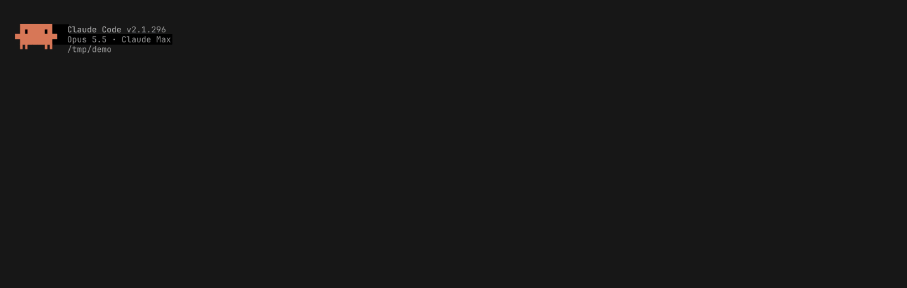

# sidebar

An always-on sidebar for Claude Code that other plugins put their tools on: a strip of tool icons with badges down
the right edge of the transcript, on/off switches under them, and for a tool that wants one, a drawer it fills with
its own panel and a pop-out area for things that can't wait.



It's a Claude Code mod with no tools of its own. [secrets](https://github.com/wfthkttn/claude-secrets) is built on it.

Provided as is.

## Requirements

- Claude Code 2.1.287 or later (mods), in [fullscreen rendering](https://code.claude.com/docs/en/fullscreen). Outside
  fullscreen nothing is drawn.
- A terminal that Claude Code draws mods in: the CLI, or the Code tab of the Desktop app.

## Install

This repository is also a marketplace, `wfthkttn`, that lists the sidebar:

```
/plugin install sidebar --marketplace wfthkttn/sidebar
```

Or load it from a directory: the plugin is this repository's root. Clone it and list the clone in
`~/.claude/settings.json`:

```json
"env": { "CLAUDE_CODE_PLUGIN_DIRS": "/path/to/sidebar" }
```

On NixOS, the flake's package puts it at `share/sidebar/claude-code`:

```nix
environment.systemPackages = [ inputs.sidebar.packages.x86_64-linux.default ];
environment.pathsToLink = [ "/share/sidebar" ];
```

and the directory to list is `/run/current-system/sw/share/sidebar/claude-code`.

`/sidebar` hides the sidebar, strip, drawer and pop-outs, until you run it again, which brings them back as they
were.

## Put a tool on it

List `sidebar` under `dependencies` in your plugin's `plugin.json`, and point your `tsconfig.json` at its types
(`types/index.d.ts`) to get `$.sidebar` typed. From a plugin in another marketplace, the dependency is
`sidebar@wfthkttn`, and that marketplace's `marketplace.json` needs `"allowCrossMarketplaceDependenciesOn":
["wfthkttn"]`. Then, from `session.start`:

```ts
await $.sidebar.register({ id: 'ask', icon: '❓', short: 'ask' })          // a tab: one glyph, 1-4 characters; `order` places it
await $.sidebar.badge({ id: 'ask', count: 2, level: 'attention' })         // info | attention | urgent; 0 clears
await $.sidebar.setSwitch({ id: 'diff', short: 'diff', isOn: false })      // drawn as ○ diff / ● diff
```

A press on a tab or a switch raises `sidebar.press` with `element: 'tool:<id>'` or `'switch:<id>'`:

```ts
on('sidebar.press', async ($, e, next) => {
  if (e.element === 'tool:ask') await $.ui.toast('Questions pressed')
  return next(e)
})
```

`examples/demo-tool` is a complete plugin that does this.

### A drawer and a pop-out

Register with `drawerColumns` (20 or more, frame included) and the tool gets a drawer, opened by its tab or by
`$.sidebar.select({ id })`, and a pop-out area at the top, shown with `$.sidebar.popout({ id, isShown })`. Each holds
an empty `Box` keyed `sidebar-drawer:<id>` or `sidebar-popout:<id>`. Fill it in your own `ui.render` hook on the
transcript row components (`SidebarRowComponent`), in the tree `next(e)` returns; `$.sidebar.room({})` says how many
rows the drawer and the pop-out have, and how many columns the drawer's frame takes.

### A gauge

`$.sidebar.gauge({ id, columns })` draws the tool's tab as bars in a tab's frame, 3 rows of them: up to 3 columns, each a
pair of bars (percent left, 0-100, filled from the bottom, red at 10 or below), each in its own color, over its
letter in the left one's. A bar given as a pair of values is split into two half-width bars in its one cell and
color, coarser (6 steps of height instead of 24) and red when either is low. `isDim`
draws a column dim with `?` for its letter. `columns: null` draws the icon again. A press on it is a press on the tab.

## Things a tool author should know

- The strip, the drawer and the pop-out are drawn over the bottom transcript row on screen, so they move to another
  row's tree whenever a new row appears. A `Client` drawn in a slot is then a new instance with its local state gone:
  keep any state that must survive (an open form, a selection) in your hooks module and hand it back through
  props. The keyboard can't be handed back: while the person types into a slot, call `$.sidebar.hold({ id, isHeld:
  true })`, and the overlays stay on that row too, the instance and its keys with them, while the newest row draws a
  copy on top. Draw the copy (`$.sidebar.mirrored`) from your hooks' state; when the copy gets a click, let go and
  hold again to move the hold to its row. Let go (`isHeld: false`) once a key reaches the prompt.
- The overlays are placed with a renderer behaviour the mod typings don't promise (a box placed far above the screen
  lands on the transcript's top row in fullscreen). A Claude Code update can move them.
- `room` is null outside fullscreen and before the transcript's height is known; draw nothing then.

## Test

```sh
claude plugin test && claude plugin validate .
```

## Licence

MIT, see [LICENSE](LICENSE).
